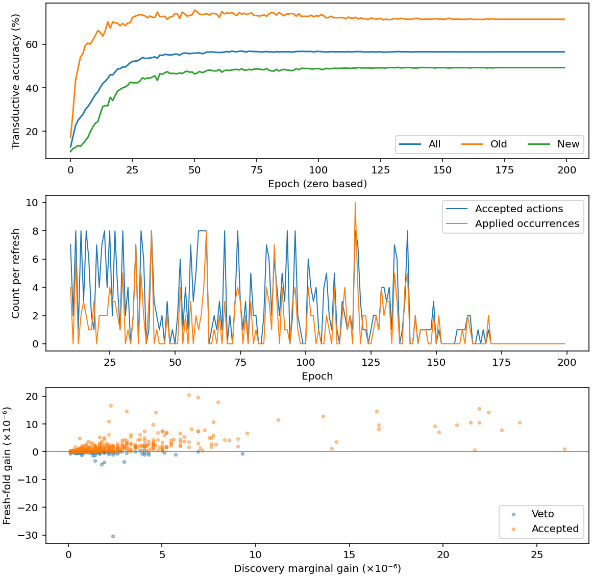
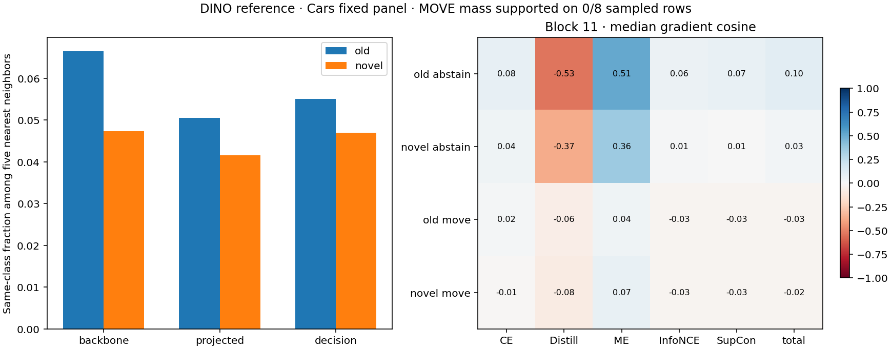

# What SimGCD + CRiSH repairs on Stanford Cars

**Finding.** E3 changes a soft target in a classifier loss. Its proposal uses a backbone neighborhood, its verification measures a one-step change in decision probabilities, and its real update reaches the backbone through the classifier. Those three objects have different derivatives. In the recorded run only **250 of 1,532,160 sampled post-warmup rows** received an edit. More than a third of accepted confirmations had a negative reconstructed unlabeled component. Neither the verification criterion nor these measurements establishes improved semantic neighborhoods.

## Evidence and provenance

| Evidence | Revision or artifact | What it can establish |
|---|---|---|
| Official SimGCD | CVMI-Lab/SimGCD @ f843f27195701b7c8c5713cfd17499ad67c86247 | Architecture, loss and transductive evaluator. See [Wen et al., ICCV 2023, §§3–4](https://openaccess.thecvf.com/content/ICCV2023/papers/Wen_Parametric_Classification_for_Generalized_Category_Discovery_A_Baseline_Study_ICCV_2023_paper.pdf). |
| Original CRiSH | feat/local-adaptive-acceptance @ 1c6ada810b451e5a1f3b36b930c550489917cf0a | Manuscript, original method audit, implementation and distinction between graph, projector and probe. [Manuscript at source revision](https://github.com/hokylhoangkien/gcd-final/blob/1c6ada810b451e5a1f3b36b930c550489917cf0a/paper/manuscript.tex) |
| E3 training | a63f29caa2be4355f6f977b1394a46ca2b4db752, run seed 1, epoch 199 | All 200 stdout evaluations, 190 paired refresh/exposure records. Three tar members are byte-for-byte duplicates of the extracted manifest, stdout and ledger. Checkpoint save messages reference a path on the training server. |
| E3-F training | 0b992da6e165bcfec02a4566046e051a29c968d6, fallback on, persistence off | Aggregates manually recovered from terminal outputs. The server was terminated and the raw ledger/checkpoint permanently lost. [Complete recovered record](E3F_RECOVERED_RESULTS.md) |
| Final/intermediate weights and E0 | Researcher confirmed E3 has no available checkpoint either. No matched baseline run manifest in the supplied artifacts | No E3/E3-F endpoint geometry, training-phase parameter gradients, per-step replay, or matched baseline improvement can be measured. A SelEx-family run and pretrained DINO weights do not meet the E0 protocol. |
| Bounded independent diagnostic | RTX 3050 Ti Laptop GPU, official DINOv1 ViT-B/16 initialization plus an independently seeded random SimGCD head | Measures geometry, exposure-selection differences at initialization and gradient sensitivity on a separate deterministic Cars panel. It does not reconstruct the original run's random head or any training epoch. |

The historical branch calls the cap-8 adaptive policy E3. The later suite launcher also offers a cap-1 mode named E3-fixed. This report uses the manifest and the actual stdout configuration of the cap-8 run. Matching a mode string alone would select the wrong control. Neither training nor checkpoint selection was run during this audit.

## Objective and gradients in the executed SimGCD code

Index the two views of each of $B=128$ images by $a=(i,v)$, with $\bar a=(i,1-v)$, $M=2B$, and labeled index set $L$. Let $h_a=f_\theta(x_a)$ be the 768-dimensional final CLS vector, $u_a=h_a/\|h_a\|$, $s_a=\mathrm{norm}(P_\phi(h_a))$ the normalized 256-dimensional projection, and $w_k=g_k v_k/\|v_k\|$ the classifier's normalized prototype with frozen scale $g_k=1$. The raw logit is $z_{ak}=w_k^\top u_a$. The prototype classifier consumes $u_a$ directly. The MLP and classifier are sibling branches in [DINOHead.forward](../model.py).

Write $p_a=\mathrm{softmax}(z_a/\tau_s)$ and $q_a=\mathrm{sg}[\mathrm{softmax}(z_a/\tau_t)]$, where $\mathrm{sg}$ stops gradients. Both distributions come from the same forward pass. The student temperature is 0.1. The teacher follows 30 evenly spaced values from 0.07 to 0.04 inclusive and then stays at 0.04. There is no EMA network or running center in this code path. Define $H(t,p)=-\sum_k t_k\log p_k$. The actual reduction in [train.train](../train.py) and [DistillLoss.forward](../model.py) is

$$
\begin{aligned}
C &= (2|L|)^{-1}\sum_{i\in L,v} H(e_{y_i},p_{iv}),\\
D &= M^{-1}\sum_a H(q_{\bar a},p_a),\quad
E=\log K+\sum_k\bar p_k\log\bar p_k,\quad \bar p=M^{-1}\sum_a p_a,\\
c_{ab}(t,S)&=\frac{\exp(s_a^\top s_b/t)}{\sum_{j\in S,\ j\ne a}\exp(s_a^\top s_j/t)},\\
I &= -M^{-1}\sum_a\log c_{a\bar a}(1,\mathrm{all}),\\
S &= -(2|L|)^{-1}\sum_{a\in L^\pm}\frac{1}{|\mathcal P_a|}\sum_{b\in\mathcal P_a}\log c_{ab}(0.07,L^\pm),\\
\mathcal L &= 0.65(D+E+I)+0.35(C+S).
\end{aligned}
$$

Here $L^\pm$ contains both views of legally labeled rows, $\mathcal P_a$ contains all other labeled views with the same label including the opposite view, and $K=196$. The implemented $D$ includes **all** rows, including known labeled rows. CRiSH eligibility is restricted to the unlabeled subset. The evaluator uses a single Hungarian assignment on all unlabeled training images before reporting Old and New fractions separately. Old refers to a class, not to membership in $L$. [Evaluation source](../util/cluster_and_log_utils.py)

### Target edits and differential geometry

For an accepted sample, [corrected_distill](../crish/repair.py) makes the same edit to each opposite-view teacher distribution. KEEP uses $t=q$. MOVE from slot $c$ to $d$ uses $t=q+m(e_d-e_c)$ with $m=0.2$ and both source masses at least $m$. ABSTAIN uses $t=0$. The original denominator $M$ survives every edit. A guarded training occurrence that misses its source or fails its mass check uses KEEP. Let $\lambda=0.65$. The **weighted distillation contribution** and the differential from KEEP on each affected student view are

| Action | $\partial (\lambda D)/\partial z_a$ | $\delta_a=\nabla_{z_a}(\lambda D_{\rm edit}-\lambda D_{\rm keep})$ |
|---|---|---|
| KEEP | $\lambda(p_a-q_{\bar a})/(M\tau_s)$ | $0$ |
| MOVE | $\lambda(p_a-q_{\bar a}+m(e_c-e_d))/(M\tau_s)$ | $\lambda m(e_c-e_d)/(M\tau_s)$ |
| ABSTAIN | $0$ | $\lambda(q_{\bar a}-p_a)/(M\tau_s)$ |

The general derivative for an unnormalized target is $\lambda[(\sum_k t_k)p_a-t]/(M\tau_s)$. Substituting $p_a-t$ for ABSTAIN would introduce a spurious gradient. For every action the total loss gradient also contains all unaffected terms. For example $\partial E/\partial z_a=(\mathrm{diag}(p_a)-p_ap_a^\top)(1+\log\bar p)/(M\tau_s)$. This is one reason a masked row can still move.

For either the absolute distillation gradient or its differential, write $d_a$ for the corresponding logit derivative in the table. Define $T(x)=I-\hat x\hat x^\top$. The classifier and backbone receive

$$
\nabla_{v_k}=\frac{g_k}{\|v_k\|}T(v_k)\sum_a d_{ak}u_a,\qquad
\nabla_{h_a}=\frac{1}{\|h_a\|}T(h_a)\sum_k d_{ak}w_k,\qquad
\nabla_{\theta}=\sum_a J_{f_\theta(x_a)}^\top\nabla_{h_a},\qquad
\nabla_{\phi}=0.
$$

These expressions assume nonzero norms above the normalization epsilon. Real SGD finetunes block 11, the projector MLP and prototype directions. Contrastive losses train the MLP and backbone, with no direct prototype gradient. The repair delta can conflict with both contrastive terms through shared block parameters, even when its classifier gradient is orthogonal or a comparison is undefined. On independent per-row $h$, the labeled CE and supervised contrastive gradients have disjoint support from an unlabeled repair. Projected outputs may move on future steps because $h$ moves.

For a single supported MOVE the two raw logits receive opposite signed shifts of 0.005078125 in each view. The Frobenius norm across both views is **0.01015625**. Halving the mass halves this local differential exactly at fixed source, target and logits. It also changes future eligibility if used by a selector. These effects cannot be conflated. The two-view ABSTAIN norm ranges from zero to **0.05078125**. It vanishes if each student matches the opposite sharpened teacher. Distinct edited rows add in quadrature in logit space. At shared parameters their directions can add or cancel. Dividing by surviving rows instead of $M$ would rescale every surviving gradient and would implement another method. The scoring batch of 256 halves the single-edit coefficient relative to a real batch of 128.

### What geometry does verification measure?

| Component | Original CRiSH | SimGCD port | Consequence for interpretation |
|---|---|---|---|
| Evidence | Reciprocal cross-view neighbors on frozen normalized backbone features and hierarchical partition boundaries | Global center-view snapshot, classifier-induced slots, exact global shortlist, local augmented graph | Feature geometry proposes the row and target. |
| Supervision | MOVE rebuilds assignment/centers/radii and the USE and pseudo-SSE terms. ABSTAIN removes eligible cross-ID pseudo positives with protected original coefficients | MOVE shifts teacher probability mass. ABSTAIN zeros only the selected row's cross-view distillation contribution | The port has no explicit attraction toward a peer feature or direct term for local compactness. |
| Virtual step | Projector-only clone with reconstructed SelEx loss | Exact functional classifier SGD on detached normalized features | Virtual changes affect decisions, with identically zero change in backbone and MLP embeddings. |
| Probe | Class-balanced legal supervised contrast on negative Euclidean distance, opposite-view normalized embedding MSE, variance floor. Default weights 1, 1, 0.1 | Known CE plus opposite-view classifier-distribution CE | Acceptance tests changes to probability and decision geometry on held-out IDs. |
| Real update | Trainable backbone and projector learn through SelEx losses | Real classifier and backbone receive edited distillation. SimGCD representation losses remain active | A feature-geometry benefit is possible, indirect and unverified. |

### Exact counterfactual and its missing term

For each epoch from 10 onward, reserve ID-disjoint folds before proposal sampling. Each fold has 32 legal known and 64 unlabeled IDs. On the non-probe set use exact top-5 neighbors of sampled anchors in the global center-view snapshot, fill a 512-ID cache, then build the two-trial, two-view neighbor graph **within that cache**. If $R_{ij}^{tv}$ denotes reciprocal kNN membership, the active weight is $r_{ij}=\frac12\sum_t R_{ij}^{t1}R_{ij}^{t2}$. For incident positive edges, define slot support $s_i(k)=\sum_j r_{ij}1[\hat c_j=k]$. Rank by $(\sum_k s_i(k)-2s_i(c_i))/\deg(i)$, with ID tie-break. Keep up to 64 boundaries. MOVE takes the highest-supported admissible other slot, with source size at least 3 and target size at least 2. ABSTAIN competes separately. The 256-row score batch includes candidate rows, partition peers and context. A fresh teacher check enforces source identity and MOVE mass. [Refresh and real exposure](../crish/global_repair.py) · [Sparse graph](../crish/reliability.py) · [Shortlist](../crish/sampling.py)

For a plan $A$, $F_A=.65(D_A+E)+.35C$ on fixed scoring features. With prototype directions $V$, stored momentum $b$, decay $\omega=5\cdot10^{-5}$, momentum $\mu=.9$, actual scheduled learning rate $\eta$, and ordinary non-Nesterov SGD,

$$
g_A=\nabla_V F_A+\omega V,\qquad b_A=\mu b+g_A,\qquad V_A=V-\eta b_A .
$$

A missing buffer initializes to $g_A$. Every plan starts from the **same** $V,b$, teacher and features. $V_{A+a}$ denotes one virtual step on the entire edited plan, not a second step on $V_A$. Thus $V_{A+a}-V_A=-\eta\nabla_V(F_{A+a}-F_A)$ up to rounding. The representation losses are independent of $V$ conditional on features. This justifies omitting them only for that parameter subset. Cached state, functional weights, detached targets, eval-mode refresh and saved/restored RNG prevent the virtual branches from training the live model. [VirtualClassifier](../crish/repair.py)

For a fold $H=(L_H,U_H)$, let $\pi_{iv}(V)=\mathrm{softmax}(Wu_{iv}/.1)$ with weights parameterized by $V$, and $r_{iv}=\mathrm{sg}[\pi_{iv}(V_{\rm initial})]$. Both branches see the identical anchor and crops:

$$
J_H(V')=\frac1{2|L_H|}\sum_{i\in L_H,v}H(e_{y_i},\pi_{iv}(V'))
+\frac1{2|U_H|}\sum_{i\in U_H,v}H(r_{i,1-v},\pi_{iv}(V'))=K_H(V')+U_H(V').
$$

Discovery requires positive marginal $J_H(V_A)-J_H(V_{A+a})$ **and** positive group $J_H(V_\emptyset)-J_H(V_{A+a})$, plus $K_H(V_{A+a})\leq\min(K_H(V_A),K_H(V_\emptyset))$. Rank by marginal gain. Repeat the identical tests on a fresh fold. E3 stops on veto. E3-F excludes the vetoed candidate and uses the next discovery-ranked alternative on a fresh fold, up to 12 attempts and eight accepts. Fallback reserves extra IDs even if retries are never needed, which can alter evidence context. The sign diagnostic groups the known fold by 16 classes, averages both views per ID, and pairs each class block with four unlabeled IDs. With $s$ strictly positive block improvements out of $b$ blocks, $p=2^{-b}\sum_{k=s}^b{b\choose k}$, adjusted to $\min(1,12p)$. Ties are nonpositive. This is descriptive under assumptions on conditional block signs. It does not gate acceptance, certify semantic improvement, or control false accepted edits across 190 adaptive refreshes. [Fallback and sign implementation](../crish/confirmation.py)

First order, a positive virtual gain estimates $\eta\langle\nabla_V J,\delta g_V\rangle$ near the factual branch. A real update on both $(V,\theta)$ introduces $\eta\langle\nabla_\theta J,\delta g_\theta\rangle$ as well as different base gradients, augmentations, sampled rows and normalization. A semantic geometry functional $G$ has its own gradients. For $G$ depending only on backbone features, $\nabla_V G=0$ exactly. Even a perfect predictor of the **virtual** change in $J$ therefore need not predict the sign of the **real** change in $G$. A global old/novel ACC difference cannot identify this missing term.

## Measurements from the full runs

| Cars, final epoch, seed 1 | All (%) | Old (%) | New (%) | Accepted actions | Applied occurrences | Timeouts |
|---|---:|---:|---:|---:|---:|---:|
| E3, verified from stdout and ledger | 56.51 | 71.51 | 49.26 | 455 | 250 | 0 |
| E3-F, manually recovered terminal aggregate | 56.49 | 73.36 | 48.35 | 964 | 549 | 0 |
| E3-F minus E3 | −0.02 pp | +1.85 pp | −0.91 pp | +509 | +299 | 0 |

A single paired seed with different selected rows and dose cannot attribute the old/new shift to fallback, the known guard, teacher bias or an individual loss. The weighted All score also reflects unequal old and novel sample counts. The E3-F count of 549 includes repeated occurrences. Dividing it by 964 does not yield the probability that an accepted ID was exposed.

| Mechanism | E3 verified from artifacts | E3-F recovered from terminal |
|---|---:|---:|
| Fresh confirmation attempts; accepted fraction | 606; 75.1% | 1,597; 60.4% |
| Gain veto / positive-gain known veto | 144 / 7 | 597 / 36 |
| Accepted ABSTAIN / MOVE | 321 / 134 | 708 / 256 |
| Applied ABSTAIN / MOVE | 170 / 80 | 416 / 133 |
| Applied ID–epochs / accepted ID–epochs | 189/455 (41.5%) | 422/964 (43.8%) |
| Applied occurrences / 1,532,160 training rows | .0163% | .0358% |
| Encounters / stale source / insufficient mass | 296 / 45 / 1 | 616 / 65 / 2 |
| Accepted / applied in first 99 refreshes | 348 / 170 | 696 / 366 |
| Accepted / applied in last 91 refreshes | 107 / 80 | 268 / 183 |
| Mean / maximum refresh duration (s) | 35.363 / 44.271 | 49.583 / 54.466 |
| Total refresh overhead (h) | 1.8664 | 2.6169 |

Fallback was associated with 991 more confirmations, 509 more accepts and 299 more applied occurrences. ABSTAIN accounted for 246/299 additional occurrences. The fraction of accepted ID–epochs ever applied rose by only 2.2 percentage points (unrounded rates). Budget/cap/discovery/ranking exhaustion ended 68/56/47/19 E3-F refreshes. On each budget stop there were 12 attempts with fewer than eight accepts, so several candidates necessarily failed fresh confirmation. The totals bound the number of rank>1 attempts. There were 964 successful ranking rounds, 19 exhausted rounds, and from zero to 68 final unsuccessful budget rounds. Cap and discovery stops add no terminal confirmation round. Subtracting one first-ranked attempt per such round from 1,597 gives **546–614 retry attempts (34.2–38.4%)**. How many of those retries succeeded is unknown. Both runs took 11,970 post-warmup optimizer steps. The mean overhead difference of 14.22 s/refresh is descriptive because hardware/load comparability is unverified.

### E3 historical exposure and confirmation

The 190 fresh plans contained 134 MOVE and 321 ABSTAIN actions across 416 distinct IDs. **189/455 (41.5%)** accepted ID–epoch pairs received at least one successful application. **266** never applied within their accepted epoch. The sampler produced 296 encounters. Current-teacher source checks rejected 45 and one MOVE lacked source mass. The remaining **80 MOVE + 170 ABSTAIN** occurrences touched 176 distinct IDs over 11,970 optimizer steps. That is one edited occurrence per 6,129.6 training rows, or **0.0163%**. Even attributing one step to each occurrence gives an upper bound of 2.09% of steps directly edited. Later optimizer momentum and shared parameters can propagate the perturbation beyond that step. The ledger does not identify all individual minibatches or within-epoch repeat multiplicities per ID.

| Epoch, inclusive | Tested on fresh fold | Accepted | Applied MOVE / ABSTAIN | Applied ID–epochs | Accepted old / novel MOVE | Accepted old / novel ABSTAIN | Median accepted confirmation, ×10⁻⁶ | Within-phase discovery/confirmation Spearman |
|---|---:|---:|---:|---:|---:|---:|---:|---:|
| 10–49 | 188 | 157 | 29 / 50 | 61 | 7 / 49 | 11 / 90 | 2.146 | .514 |
| 50–99 | 206 | 164 | 26 / 54 | 59 | 14 / 30 | 20 / 100 | .775 | .505 |
| 100–149 | 166 | 122 | 20 / 63 | 64 | 12 / 16 | 15 / 79 | .358 | .518 |
| 150–199 | 46 | 12 | 5 / 3 | 5 | 2 / 4 | 1 / 5 | .179 | .237 |

Epochs 0–9 were warmup. Final 50 epochs had only 8 applied occurrences. Epoch 170 was the last epoch with any acceptance or application; the final 29 epochs had none. The cosine learning-rate schedule reduces the virtual parameter displacement late in training; many marginal differences have the size of a few float32 spacings. Signal strength, parameter curvature and a rounding floor are competing explanations. The logs contain neither high-precision reevaluations nor per-phase gradient vectors.

Across **49,444 candidate-round scores** (including repeated candidates at different plan sizes), 19,661 had positive discovery gain. Median discovery gain over all scores was zero, with 12,998 exact zero differences. Among 606 selected for confirmation, median discovery gain was $1.43\cdot10^{-6}$ and median fresh gain $4.77\cdot10^{-7}$. Spearman $\rho=.636$ across selected attempts. Phase-stratified correlations are smaller. Selection of winners and epoch-dependent learning rate prevent interpreting this as a calibration coefficient on all candidates. Of 151 vetoes, 144 failed the marginal or group gain test, seven had positive gains but failed the known guard. The tests are ordered, so additional guard failures may overlap the 144. Refreshes stopped 151 times on confirmation, 20 on discovery and 19 on the cap. Median duration 33.82 s, range 30.23–44.27 s, on the original training host.

For accepted actions, median fresh total gain was $9.54\cdot10^{-7}$; median marginal change in known CE, trial minus factual, was $-7.90\cdot10^{-7}$. The independently computed medians do not add. Per attempt the **unlabeled** proxy benefit equals total gain **plus** logged known delta. Its median was $4.84\cdot10^{-8}$; 167/455 were negative and five exactly zero at the precision of the logged scalars. Only four reconstructed declines had magnitude above one millionth of a loss unit; 18 improvements exceeded that same magnitude. This descriptive scale check illustrates why the 167 negative signs cannot establish 167 materially worse outcomes. Cancellation in subtracting float32 totals limits fine sign interpretations. A held-out probe prevents the trivial reward for zeroing a training target; the joint objective can nevertheless pass an action that worsens the unlabeled term. Conversely a more teacher-consistent distribution can remain semantically wrong.

Ground truth was joined **after** all interventions. Round zero included 2,302 old and 8,956 novel candidate ID–epochs; accepted actions were 82 old / 373 novel. Applied ID–epochs were 33 old / 156 novel. Among 35 accepted MOVE actions on hidden-old examples (34 distinct IDs), 17 transferred mass **toward** the legally anchored true-class slot, 13 **away**, and five between two other slots. Of these, 10/7/2, respectively, actually reached at least one optimizer step. These signs describe the direct target change in the anchored true-label coordinate, not the effect on a learned embedding. Within these 35 selected actions, Spearman against that three-level direction (+1/−1/0) was .012 for discovery gain and −.032 for confirmation gain. Both toward and away had the same median confirmation gain, $1.19\cdot10^{-6}$. This is a small, selected, old-only diagnostic. Novel slots have no legal identity mapping. Never apply the anchored-slot test to them by numbering their labels.

For a hidden-old example the logit-space inner product of the MOVE differential with an offline oracle CE gradient has the sign of $p_c-p_d-1[y=c]+1[y=d]$ per view. Thus the 17 moves toward the anchored class agree with supervised descent and the 13 away conflict, regardless of the missing logits (strict for finite nonsaturated probabilities). The other five are indeterminate. Toward/away/neither by phase were 1/4/2, 6/6/2, 8/3/1 and 2/0/0. This establishes a historical direction for those proposed targets. Applying the shared feature and weight Jacobians can change the sign of an inner product. Across the 80 actual MOVE occurrences, the concatenated logit-gradient differential has Frobenius norm $\sqrt{80}\,0.01015625=0.09084$. With the 170 ABSTAIN occurrences included, the corresponding concatenated norm lies between 0.09084 and 0.66831. This is across distinct occurrence coordinates, not the norm of accumulated SGD.

**Identification limit.** E3 stops on the first veto, so every confirmed winner has discovery rank 1. The E3 ledger does not record per-block signs. E3-F's recovered counts cannot identify how many rank>1 trials passed, their corrected sign statistics, or occupancy changes. E3-F rank/sign analysis was skipped after permanent artifact loss. Historical factual/counterfactual embedding trajectories, per-image pre/post representations and gradients are absent. Consequently there is **no measured correlation between predicted gain and actual improvement in geometry**. Neither the old-slot diagnostic nor discovery/confirmation correlation replaces this estimand. Even two final checkpoints alone would not provide action-level causal effects.

*Top: official transductive evaluations. Middle: accepted plans and actual optimizer occurrences. Bottom: selected candidates on the same discovery fold and their first fresh confirmation. A point below zero passed discovery but regressed on the marginal held-out objective.* [Historical aggregates and input hashes](mechanistic/e3-history.json)

## Snapshot diagnostic on the available GPU

The geometry panel samples five officially unlabeled training IDs per class, uniformly without replacement (980 images). Labels are used only by the offline evaluator for balanced reporting, matching and metrics. Center crops estimate static geometry; two independently ID-seeded training crops estimate stability. The gradient batch is a separate fixed draw of 64 legal known + 64 unlabeled images, with the original batch denominator and temperatures; only labeled indices enter CE/SupCon. It is a diagnostic composition rather than a replay of the sampler. Each checkpoint uses identical IDs and crops. A microbatch of four changes only image encoding and the vector–Jacobian products. Full-batch head terms still see all 256 views. This diagnostic uses FP32, final CLS features, normalized projected features, and normalized student probability vectors for cosine geometry. It never calls a training optimizer step.

### Geometry at DINO initialization with a random head

| Space | Own centroid cosine ↑ | Nearest other centroid distance ↑ | kNN-5 purity old / novel ↑ | Mean silhouette ↑ | Own vs nearest-other margin ↑ | Two-crop cosine ↑ | Occupied partition alignment |
|---|---:|---:|---:|---:|---:|---:|---:|
| Backbone | .7570 | .0838 | .0665 / .0473 | −.2007 | −.0636 | .9504 | .8340 |
| MLP projection | .7876 | .0682 | .0506 / .0416 | −.1980 | −.0565 | .9498 | .8625 |
| Classifier probabilities | .9720 | .0075 | .0551 / .0469 | −.2201 | −.0079 | .9937 | .9810 |

Own compactness uses a leave-one-out unit class centroid. Inter-centroid separation is mean nearest **different** class centroid cosine distance. Per-ID semantic margin subtracts the highest other-centroid similarity from leave-one-out own similarity. Silhouette uses cosine distance and all classes. Partition alignment matches occupied predicted centroids to distinct semantic centroids by Hungarian cosine; coverage matters because just **49/196** classifier slots were occupied. In backbone space, direct cosine alignment of learned classifier directions to semantic centroids after Hungarian matching was .0389; old slot identity alignment was −.0004. A probability space concentrated near the uniform simplex center can have high cosine across crops and low semantic purity simultaneously.

Mean top-two probability margin was .00208, with 67.55% two-crop slot agreement. On the fixed panel 72.91% of same-class pairs were **split** between different predicted slots; 99.50% of same-slot pairs were **merged** across true classes. After one panel-wide Hungarian mapping, old→new was 27.96% and new→old 69.59%. Assignment among tied/empty slots and the five-per-class design affect these estimates. These are initialization diagnostics of an untrained classifier. They do not describe either trained model.

The panel has only four eligible same-class neighbors per query. Its purity@5 upper bound is 0.8; uniformly random neighbors give an expected 4/979 ≈ 0.0041. Values on the full imbalanced Cars split would use different opportunities for same-class matches.

For each ever-applied E3 ID in the panel, greedily match one never-applied ID from the same semantic class, minimizing the difference in historical round-zero proposal frequency with deterministic ID tie-break, without replacement. The 27 matched pairs yield these mean within-pair differences (ever-applied minus control):

| Space | Own compactness | Purity@5 | Silhouette | Semantic margin | Two-crop stability |
|---|---:|---:|---:|---:|---:|
| Backbone | −.0527 | −.0148 | −.0021 | −.0340 | −.0084 |
| Projected | −.0372 | −.0074 | +.0267 | −.0177 | −.0086 |
| Decisions | −.0072 | −.0148 | −.0132 | −.0048 | −.0014 |

These differences precede the recorded treatments. Matching within class cannot remove confounding by changing teacher slots, boundary ambiguity, repeated eligibility or sampler draws. An endpoint difference for this panel would still mix background training and repair effects.

### Differential gradients at the same initialization

Each comparison fixes the input, head and legal targets. It measures the differential $\delta g=\nabla(\mathcal L_{\rm edit}-\mathcal L_{\rm KEEP})$ and each **weighted** SimGCD term. We cache inputs to block 11 and sum exact microbatch vector–Jacobian products in that block's parameter space. Raw gradient magnitudes are coordinate dependent; compare ratios within a column. The optimizer momentum direction is a different quantity.

| Gradient norm | CLS features $h$ | Weight directions $V$ | Block 11 parameters |
|---|---:|---:|---:|
| $.35C$ | .004647 | .80179 | .36310 |
| $.65D$ | .000114 | .08819 | .03599 |
| $.65E$ | .000144 | .18904 | .07914 |
| $.65I$ | .001424 | 0 | .36216 |
| $.35S$ | .010719 | 0 | 1.05433 |
| Total | .012286 | .82448 | 1.42800 |

Eight unlabeled rows were drawn without inspecting their hidden labels. We tested ABSTAIN sensitivity and the source-to-runner-up MOVE direction on exactly those rows. The latter isolates the differential, with **0/8** rows supporting mass 0.2 at the randomly initialized head. The selector did not propose or accept these edits. ABSTAIN is algebraically admissible but its graph/probe eligibility was not evaluated. No artificial teacher sharpening was used on Cars.

| Action and offline class | n | Median block-11 delta norm | Delta / total norm | Median cosines with CE / D / ME / InfoNCE / SupCon / total | Negative counts in the same order |
|---|---:|---:|---:|---|---|
| ABSTAIN old | 5 | .000573 | .0402% | .081 / −.532 / .514 / .058 / .070 / .102 | 0 / 5 / 0 / 1 / 1 / 1 |
| ABSTAIN novel | 3 | .000531 | .0372% | .042 / −.375 / .363 / .011 / .006 / .029 | 0 / 3 / 0 / 1 / 1 / 0 |
| MOVE sensitivity old | 5 | .011199 | .784% | .017 / −.063 / .040 / −.026 / −.031 / −.029 | 1 / 5 / 0 / 5 / 5 / 5 |
| MOVE sensitivity novel | 3 | .010315 | .722% | −.008 / −.081 / .072 / −.029 / −.030 / −.024 | 2 / 2 / 1 / 2 / 2 / 2 |

On $V$, median ratios to the full gradient for ABSTAIN old/novel were .143%/.137%; for the formal MOVE direction, 2.940%/2.914%. On $h$ they were .078%/.079% and 1.251%/1.199%. The zero classifier gradients of InfoNCE and SupCon give undefined cosines, recorded as null. One can see different alignment across parameter subsets even at the same snapshot: old MOVE had slightly positive median cosine with the total classifier gradient (+.014) yet negative median block-11 cosine (−.029). Gradient opposition to a baseline objective is not itself an error; the purpose of a correction can be to oppose erroneous supervision. What is established historically is low exposure, especially late. What is measured at initialization is a small ABSTAIN delta alongside a much larger supervised contrastive block gradient. The magnitude, dominance and semantic sign of actual historical repaired gradients remain open.

The [snapshot JSON](mechanistic/dino-reference.json) contains per-ID norms, signed cosines against all terms in all three spaces, layer norms, hashes, paired IDs and subgroup geometry. A controlled CPU derivative check against the production loss passed for KEEP, ABSTAIN and two supported MOVE masses. The two-view MOVE norms at mass .1 and .2 were .00507813 and .01015625. The test also verifies the feature/weight Jacobians and the exact differential of momentum SGD with nonzero stored state. No test constructs an E3/E3-F historical gradient.

## Ranked research recommendations

Ranking is based on identifiability of the proposed mechanism, compatibility with SimGCD, and compute. Hidden Cars labels and the panel metrics above must stay sealed from training, acceptance decisions, threshold tuning and model selection. All three preserve the original sampler and its possibility of zero exposure. They are proposals; none was implemented or trained in this audit.

### 1. Feature-level counterfactual update with an independent geometry probe

**Question.** Can the existing distillation edit improve held-out embeddings through the parameters that real training actually moves? Keep the original MOVE/ABSTAIN/KEEP training objectives. Cache tokens entering the final trainable block. Pair two exact functional SGD steps on the same score batch with the same optimizer state. Update $\psi=(\theta_{11},V)$ using the full weighted SimGCD loss, including both contrastive terms through the fixed projector. There is no need to virtually step the MLP to test an immediate backbone-only metric on this architecture. Preserve the known CE guard and strict positive marginal/group checks on fresh folds.

Define a held-out geometry objective before inspecting outcomes. One possible specification uses normalized probe embeddings $u_i$, legal same-class positives on known rows, and a fixed distribution $t_{ij}$ on unlabeled neighbors computed by a frozen DINO encoder on another view, excluded from score/proposal IDs. On disjoint discovery/confirmation ID panels let
$$
Q_{ij}=\mathrm{softmax}_{j\in S_i}(u_i^\top u_j/T),\quad
G=G_{\rm known\;SupCon}+\frac1{|U|}\sum_i H(t_i,Q_i).
$$
Use leaves of support $S_i$ determined before either update and retain the same positive/negative candidate set, transforms and frozen teacher in both branches. With frozen keys, $\partial H/\partial h_i=T(h_i)\sum_j(Q_{ij}-t_{ij})u_j/(T\|h_i\|)$; add the transpose contribution when both endpoints are updated. The first-order change in held-out geometry is $\eta\langle\nabla_{\theta_{11}}G,\delta g_{\theta_{11}}\rangle$. Evaluate the actual stepped models for acceptance. Factual and trial score no hidden labels; legal labeled classes provide the only supervised component.

**Cost and risk.** For $C$ tested plans, scoring batch $S$, probe size $H$, final-block forward/backward cost per image $F_b$ and classifier width $K$, work is roughly $O(C[(S+H)F_b+(S+H)dK])$ plus probe pair comparisons $O(CH^2d)$ when dense. CPU/off-device tokens cost $O((S+H)Ld)$ for sequence length $L$. A single-candidate state needs block weights, gradients and optimizer buffers. Reuse frozen prefix features, not trial-dependent final features. Classifier-only scoring is cheaper but any backbone-only $G$ is constant across its branches. Full ViT updates are much more expensive and introduce directions that real SimGCD freezes. An exact last-block update most directly addresses the measured architectural mismatch. The frozen graph can encode background/style and resist useful semantic changes; known-only anchors can favor old structure; a 300 s budget may permit fewer exact comparisons.

**Minimal future comparison.** Cross classifier vs last-block virtual updates with original decision probe vs feature probe on identical preselected candidate sets and fixed compute/exposure reporting. The classifier/feature cell is an analytic zero-gain control. Report per-step predicted vs observed *paired* geometry changes before any accuracy claim. A potential IJCNN contribution is verifying which parameter/probe pair predicts an intervention's realized feature effect under GCD constraints. A one-step validation-driven update alone is already established in the broader literature. [Ren et al., ICML 2018](https://proceedings.mlr.press/v80/ren18a.html)

### 2. Direct local geometry auxiliary loss on accepted boundary rows

For an accepted MOVE, let $\mu_d,\mu_c$ be detached unit peer centroids from reliable target/source neighbors excluding the anchor. On an ordinary sampled occurrence add
$$
L_{\rm local}=\frac{\beta}{2B}\sum_{i,v\ {\rm edited}}
\mathrm{softplus}((u_{iv}^\top\mu_c-u_{iv}^\top\mu_d+\gamma)/T).
$$
Retain the original probability edit. KEEP adds no auxiliary term. ABSTAIN still suppresses the disputed distillation row and does not assume a destination. For scalar argument $r$, the auxiliary derivative per view is $\beta\sigma(r)T(h)(\mu_c-\mu_d)/(2BT\|h\|)$. It directly rotates the anchor toward the target peers even when classifier directions do not point there. If legal support or current assignment has become stale, skip the occurrence. Both contrastive objectives and all unrelated losses retain their normal coefficients. Freeze the peers for one refresh and use an independently verified feature-aware virtual step as above, or state explicitly that a classifier-only confirmation cannot see this auxiliary term.

**Cost and risk.** $O(kd)$ per centroid per candidate in the cache and $O(d)$ per exposed row, beyond the exact verifier. This formulation keeps the fixed batch denominator and cannot increase sampler exposure by construction. It can amplify a spurious peer mode, repel legitimate within-class variation, or do little when most successful actions are ABSTAIN (170 of 250 historical occurrences). Fixed feature-space margin $\gamma$, $\beta$ and $T$ must be predeclared. Minority clusters can be harmed even if class-averaged probe scores pass.

**Minimal future comparison.** Same prescribed edit identities and dose, baseline distillation edit vs edit plus auxiliary loss, followed by evidence-only vs verified selection at matched dose. Report margin gain on independent same-image crops, split/merge, and actual per-loss block gradient ratios. The prospective paper contribution is counterfactual selection of a sparse, signed local feature correction with a protected abstention. Margin losses and semantic affinity learning themselves are prior art. [PromptCAL, CVPR 2023](https://openaccess.thecvf.com/content/CVPR2023/html/Zhang_PromptCAL_Contrastive_Affinity_Learning_via_Auxiliary_Prompts_for_Generalized_Novel_Category_Discovery_CVPR_2023_paper.html)

### 3. Neighborhood-level relational repair

For each candidate choose a small fixed peer support $S_i$ containing reliable source and target edges. Define baseline cross-view relational target $r_i^0$ from frozen affinities on that support and a candidate target $r_i^1$ by moving a bounded amount of mass from supported source edges to supported destination edges. ABSTAIN can remove the disputed edge term while retaining the original anchor denominator; avoid renormalizing surviving anchors. With detached peer keys $u_j^*$, set $Q_{ij}=\mathrm{softmax}_{j\in S_i}(u_i^\top u_j^*/T)$. Compare factual and trial graph supervision $H(r_i^0,Q_i)$ and $H(r_i^1,Q_i)$ with identical weight, denominator, support and negative pool. A clean paired intervention introduces the same relational baseline term in both arms; report its contribution separately when comparing against stock E3. For mass-preserving MOVE,
$$
\delta\nabla_{h_i}=\frac{\beta}{2BT\|h_i\|}T(h_i)\sum_j(r^0_{ij}-r^1_{ij})u_j^* .
$$
If several rows share a corrected edge, define degree-normalized symmetric weights in advance and account for both endpoints. Real optimizer exposure remains restricted to sampled endpoints; cached keys require no extra sampler draws. Keep a separate held-out graph for exact feature-level confirmation, including the known guard; a score on the very edited edge would reward self-agreement.

**Cost and risk.** A sparse graph needs $O(Sk)$ edges and $O(Skd)$ similarity work per refresh, with $O(kd)$ per exposed anchor on top of the verifier. Hubs, correlated edges, stale peer memory and multiple testing on overlapping neighborhoods can spread an error. Predefine whether the dose unit is an anchor, edge or total gradient mass. Matching only accepted anchors can conceal a large dose increase. Shared peers require cluster-aware error estimates.

**Minimal future comparison.** Matched anchor exposure **and** edge mass for pointwise vs relational repair, plus verified vs evidence-only relational decisions. Track changes on unseen neighboring IDs. PromptCAL learns from mined affinities; DeGCD already adds neighborhood prediction consistency and contrastive debiasing. The possible IJCNN contribution is evaluation of a bounded **counterfactual edit of relational supervision** on a separate neighborhood. Novelty would depend on discriminating it from affinity mining and ordinary graph smoothing. [PromptCAL](https://openaccess.thecvf.com/content/CVPR2023/html/Zhang_PromptCAL_Contrastive_Affinity_Learning_via_Auxiliary_Prompts_for_Generalized_Novel_Category_Discovery_CVPR_2023_paper.html) · [DeGCD, IJCAI 2025](https://ijcai.org/proceedings/2025/587)

The strongest next claim to test is local and falsifiable: given a frozen pre-step state and a particular supported edit, does independent confirmation predict the sign of its **paired real-parameter** effect? Save pre-step model and optimizer, minibatch IDs/augmentations, accepted plan and confirmation scores; replay matched factual/trial steps on clones and evaluate a held-out semantic diagnostic offline. Compare predeclared acceptance policies across several seeds/datasets only in later experiments. An endpoint gain or an IJCNN paper cannot be concluded from these two Cars scores.

## Reproduction and outstanding measurements

Run from the root of this checkout using Python 3.12 with torch 2.6.0+cu124, torchvision, Pillow, numpy, scipy, scikit-learn, pandas and matplotlib. Point the Cars path to the official layout containing the train JPEGs and devkit annotation files. Use the same local facebookresearch/dino source and ViT-B/16 weights. The input digest, GPU, IDs, RNG policy and batch construction are captured by the scripts/results. The prescribed output paths are separate from the supplied artifacts.

~~~bash
python scripts/audit_crish_history.py --ledger "$LOG/checkpoints/crish-global.jsonl" \
  --stdout "$LOG/e3-cars-20261125-013657.log" --cars "$CARS" --out reports/mechanistic/e3-history
python scripts/check_crish_derivatives.py
python scripts/audit_crish_snapshot.py --cars "$CARS" --dino-repo "$DINO_REPO" \
  --pretrained-reference "$DINO_VITB16" --ledger "$LOG/checkpoints/crish-global.jsonl" \
  --per-class 5 --micro 4 --output reports/mechanistic/dino-reference.json
python scripts/plot_crish_snapshot.py reports/mechanistic/dino-reference.json
~~~

The source checkout for local DINO was facebookresearch/dino at 7c446df5b9f45747937fb0d72314eb9f7b66930a. For an accessible E3 final or intermediate checkpoint, run the following; for matched E0 omit the ledger argument, or supply the E3 ledger to analyze the fixed E3 cohort. Use trusted checkpoint files because the official format may include pickled optimizer/RNG metadata.

~~~bash
python scripts/audit_crish_snapshot.py --cars "$CARS" --dino-repo "$DINO_REPO" \
  --checkpoint "$CHECKPOINT" --ledger "$RUN_LEDGER" --output "$AUDIT_OUT/snapshot.json"
python scripts/plot_crish_snapshot.py "$AUDIT_OUT/snapshot.json"
python scripts/audit_crish_history.py --cars "$CARS" --ledger "$RUN_LEDGER" \
  --stdout "$RUN_STDOUT" --out "$AUDIT_OUT/history"
~~~

- **Executed.** Full E3 ledger/stdout aggregation with per-epoch ID/fold checks, archive comparison, derivative identities against the source implementation, three-view reference panel, fixed-batch loss gradients and block-11 Jacobian products on CUDA, and both figures. All historical subgroup joins used offline annotations. No source under the training or CRiSH method paths was edited.
- **Unexecuted.** E3 endpoint geometry and gradients require its trained weights. Historical phase comparisons require intermediate states, and checking superiority over baseline requires a matched E0 run. E3-F endpoint, rank and block-sign diagnostics were skipped permanently per the artifact-loss update. Historical per-action geometry improvement additionally requires paired replay data or paired before/after diagnostic snapshots with strong attribution qualifications. Snapshot gradients use prescribed test directions; they cannot recover historical applied gradients.
- **E0 comparability.** Require DINOv1 ViT-B/16, frozen prefix/trainable block 11, identical SSB classes and labeled-ID split, sampler/replacement policy, batch 128, 200 epochs, teacher/optimizer schedules, augmentations, seed and evaluation v2 on the same transductive unlabeled split. Compare final to final; distinguish across-run variation, best-epoch selection and disjoint-test evaluation. A reported paper average or a different backbone/seed is insufficient.
- **Deliverables.** This report, [E3-F recovered results](E3F_RECOVERED_RESULTS.md), the [history parser](../scripts/audit_crish_history.py), [snapshot diagnostic](../scripts/audit_crish_snapshot.py), [derivative checks](../scripts/check_crish_derivatives.py), [snapshot plotter](../scripts/plot_crish_snapshot.py), two numeric JSON receipts and two PNG figures. Only diagnostic outputs are versioned.
