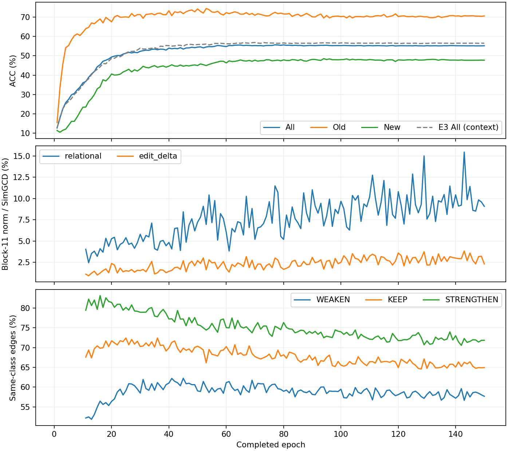
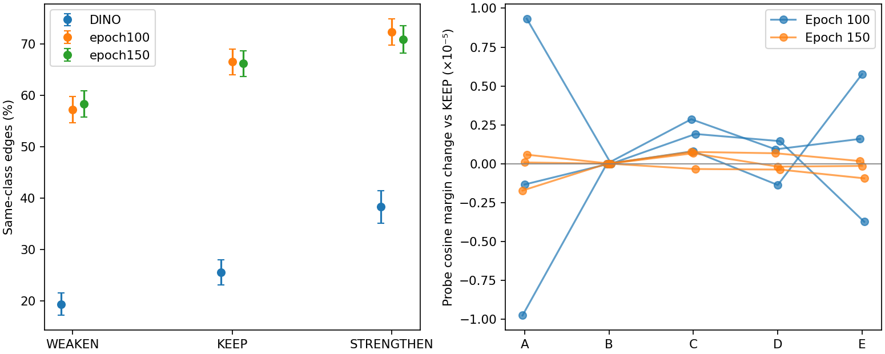

# Mechanistic audit of CRiSH-R2 on Stanford Cars

**Decision: GO for matched R0/R1 controls; NO-GO for claiming an R2 improvement.** Use the same Cars split, seed, schedule and epoch windows. R1 isolates the value of editing over KEEP; R0 isolates the value of adding graph supervision. This is the single next research direction supported by this audit.

Ranked explanations for the plateau, ordered by strength of evidence:

1. **Imperfect edge selection.** In the actual epoch-150 graph, 28.2% of strengthened edges cross classes and 57.7% of weakened edges are same-class. Stable wrong neighbors recur even when the individual edit has no exposure. This establishes a source of supervisory error, but cannot measure its contribution to the accuracy plateau.
2. **Limited immediate semantic leverage.** Against KEEP, actual edits increased mean independent-probe cosine margin by only 0.186 × 10⁻⁵ and 0.036 × 10⁻⁵ at checkpoints 100 and 150 respectively (table units are 10⁻⁵). Signed-mass-matched random edits gave +0.034 and +0.004 in the same units; oracle edits gave +0.121 and −0.030. Three batches per endpoint and unequal oracle dose cannot establish superiority or predict trajectory-level gains. Even ideal semantic signs did not consistently produce the strongest probe response.
3. **Systematic gradient conflict or vanishing exposure.** Weakest support. Late edit-gradient alignment fluctuated around zero, while relative gradient strength and exposure remained substantial. The evidence cannot identify a single causal bottleneck on one R2 trajectory.

## Run identity and integrity

The supplied SHA256 sidecar matches the 874,598,400-byte archive: `c30075fedad54a092980767c3eefd262050c6165ec75494bc02db9e5823099f6`. The archive verifier checked every one of the 14 payloads against its member manifest before extraction and checked the complete member set. Hash agreement establishes consistency with the supplied receipt. There is no external signature. Both checkpoints carry the exact run identity, completed epoch and journal offsets. The CPU sampler RNG independently replays to the epoch-100 checkpoint. All frozen backbone tensors, including the final normalization, match pretrained DINO bit-for-bit. The DINO source hash difference on Windows disappears after CRLF-to-LF normalization. The archive was generated on an RTX 3090. Snapshot diagnostics used a local RTX 3050 Ti. [Checksums and checkpoint validation](r2_audit_provenance.json)

| Field | Verified value |
|---|---|
| Source | `feat/crish-relational`, `c87de5e81391720c8e020256bed72d843584c0cb` |
| Run | Standalone R2, seed 1, Cars SSB, 6,144 unlabeled, original weighted replacement sampler, mixed batch 128 |
| Optimizer and objective | SGD, momentum .9, LR .1 with original 200-epoch cosine clock; DINOv1 ViT-B/16, trainable block 11 and SimGCD head; FP32, v2 evaluation |
| Relational settings | First active epoch 11; reciprocal k=5, base weight .5, edit .25, λ=1, fixed denominator 1,280 |
| State | Epoch 100 and 150 model, 19 optimizer state entries each, scheduler and four RNG components. At 150 the controller paused for manual review. Matched comparative guards at both milestones were UNVERIFIED. |

## Observed 150-epoch trajectory

Every completed epoch contains one metrics row and one ledger row, with 63 optimizer steps. The first ten epochs have no graph; the next 140 contain the full committed edge set, votes and applied edits. The replay samples the original merged dataset in original order, with replacement, consumes both loader iterator seeds and drops the final short batch. For **all 140 active epochs**, the replay matched every per-edge edited occurrence and the total graph exposure. This recovers the unedited KEEP encounters that the ledger only reported in aggregate. Endpoint exposure weights count both orientations and duplicate anchor draws, once per encounter across the two views. [All 150 rows, semantic joins and transitions](r2_audit_history.json)

| Completed epochs | Mean All / Old / New (%) | All slope (pp/epoch) | SimGCD / R2 relational loss | Weighted R2 / edit norm (% of SimGCD) | R2 / edit cosine with SimGCD | STRENGTHEN / WEAKEN occurrences per epoch | Effective edit mass per epoch |
|---|---|---:|---|---|---|---|---:|
| 1–10 | 26.87 / 50.69 / 15.36 | +2.346 | 5.471 / inactive | — | — | — | — |
| 11–30 | 47.58 / 68.97 / 37.26 | +.744 | 4.014 / .02210 | 4.40 / 1.46 | +.028 / −.035 | 2,318 / 3,750 | 2.370 |
| 31–60 | 54.02 / 72.37 / 45.16 | +.080 | 3.775 / .01710 | 6.36 / 1.98 | +.065 / −.036 | 2,603 / 3,541 | 2.400 |
| 61–80 | 55.41 / 71.76 / 47.51 | +.007 | 3.726 / .01430 | 7.26 / 2.17 | +.071 / −.041 | 2,740 / 3,538 | 2.452 |
| 81–100 | 55.36 / 70.82 / 47.89 | −.004 | 3.707 / .01282 | 8.35 / 2.38 | +.045 / −.014 | 2,834 / 3,524 | 2.484 |
| 101–120 | 55.25 / 70.49 / 47.88 | −.006 | 3.695 / .01136 | 9.26 / 2.91 | +.057 / −.063 | 2,928 / 3,479 | 2.503 |
| 121–150 | 55.21 / 70.44 / 47.85 | −.001 | 3.688 / .01041 | 9.75 / 2.88 | +.027 / +.001 | 3,092 / 3,405 | 2.538 |

**All accuracy plateaued around epochs 60–80**, with a single-epoch high of 55.71% at 77. This is a descriptive window inferred from the series. The recent increase in graph and edit gradient ratios rules out disappearing relative intervention strength as a sufficient account of the plateau. The cosine schedule still reduces the absolute parameter step. Mean edge count rose from 7,397 in epochs 61–80 to 7,590 in 121–150, isolated nodes changed from 1,063 to 1,082, and cross-view reciprocal-edge Jaccard rose from .268 to .286. Intervention exposure shifted gradually toward STRENGTHEN. Loss continued to fall. Gradient statistics cover the first batch of each active epoch, while exposure and loss include the full epoch.

| Completed epoch | R2 All / Old / New (%) | Historical E3 All / Old / New (%) |
|---:|---|---|
| 100 | 55.29 / 70.31 / 48.03 | 56.71 / 73.16 / 48.76 |
| 150 | 55.21 / 70.66 / 47.74 | 56.53 / 71.61 / 49.24 |

The E3 manifest and stdout support epoch-aligned descriptive comparison on seed 1, Cars SSB, batch 128, v2 and the 200-epoch clock. The training method, commit and execution environment differ. The stdout rounds accuracies to four decimal places. E3-F has only manually recovered aggregates and a final 200-epoch score; no compatible accuracy window at 100 or 150 is available. Its score does not enter any difference here. [Recovered E3-F evidence](E3F_RECOVERED_RESULTS.md)

## Semantic and geometric measurement design

**Time alignment matters.** A ledger row for completed epoch t describes the graph built from checkpoint t−1. A post-100 model supplies the center geometry for the actual epoch-101 graph. No epoch-151 ledger exists. We separately analyze the actual historical graphs and new full-split graphs rebuilt from pretrained, post-100 and post-150 parameters. For these three new graphs, each of 6,144 IDs receives the same center view and same two augmented crops across snapshots (single-worker-process loading, common seed 2079). Caching the frozen prefix within each microbatch makes this paired comparison feasible. The independent crops on the server used eight loader workers and epoch-specific seeds. Offline vote agreement can change. Exposure on a reconstructed graph is an explicit reweighting using actual recorded/replayed anchor draws; only the original ledger joins describe the historical applied actions.

Each undirected reciprocal edge is counted once. SAME means equal official Cars class. An erroneous STRENGTHEN joins different classes; an erroneous WEAKEN downweights a same-class neighbor. Old–old and novel–novel groups condition on both endpoints. A mixed old–novel edge is always wrong. For uncertainty, a dyadic sandwich sums squared endpoint score totals and subtracts one copy of the individual squared scores. Edge repeat weights enter the scores, so a frequently encountered edge does not become many independent observations. Intervals are approximate 95% conditional intervals, clipped to the probability range. They account for shared nodes, but cannot capture all class-level, model-wide or seed-level variation.

The evidence comparison uses every reciprocal edge once out of fold. Divide image IDs into five fixed folds. For each unordered pair of endpoint folds, train on edges with neither held-out fold represented and evaluate edges of that pair. Compare fixed logistic models using cubic cosine, categorical votes, or both. A positive paired Brier gain favors adding votes. These are sealed predictive diagnostics with fixed specifications. No oracle information, model choice or audit thresholds are fed back into training.

**The votes carry modest complementary information.** At 100/150, vote-only AUROC is .575/.561, below cosine-only .589/.582. Combining them gives .613/.605. The paired reduction in Brier score has a positive endpoint-robust interval at both checkpoints. On the post-100 graph, new crops recover exactly the archived epoch-101 center support, but reproduce the historical vote on only 51.4% of edges. At 150 the new graph overlaps the preceding epoch's support at Jaccard .792. The much smaller initial-model overlap with epoch 11 compares across ten ordinary warmup epochs in addition to different crops.

**Late geometry stalls, especially for Novel classes.** Full-split kNN-5 purity rises from 15.89% at DINO initialization to 57.81% at 100, then falls to 57.18% at 150. This trajectory includes all SimGCD updates and cannot attribute the initial gain to R2. At 150, Old has positive centroid margin +.1445 and silhouette +.2590; Novel has negative margin −.0355 and silhouette −.0271. From 100 to 150 the number of connected components rises from 1,491 to 1,582 and the largest falls from 87 to 60 images. The graph becomes more locally partitioned; neither this pattern nor the feature variance suggests a single collapsed cluster. The data also allow over-fragmentation within semantic classes. The tables below report compactness and separation separately.

## Temporal evidence from the committed graphs

At epoch 150 the committed graph has 678 wrong STRENGTHEN edges and 1,488 wrongly weakened same-class edges; at 100 the counts were 576 and 1,584. Thus low agreement often marks an unstable view of a **correct** link. Exposure-weighted purity among old–old / novel–novel edges at 150 was 90.0% / 69.0%. Pooled STRENGTHEN purity fell from 80.56% in epochs 11–30 to 75.12% at 61–80 and 72.03% at 121–150, even as crop-edge Jaccard increased. The corresponding WEAKEN purities were 56.71%, 59.90%, and 58.09%. Greater crop consistency across the graph did not translate to progressively better high-vote precision in this run.

Over 139 successive active refresh pairs, 81.90% of 73,488 wrong STRENGTHEN edge-epochs remained in the next reciprocal graph, versus 68.54% of 115,253 wrong KEEP and 54.99% of 154,329 wrong WEAKEN. For wrong edges already strengthened at least twice consecutively, retention was 92.83% over 29,797 edge-epochs. Among 8,433 distinct incorrectly strengthened edges, 3,094 had at least two consecutive strengthened refreshes. The next-refresh disappearance rate for wrong WEAKEN was 45.01%, so a majority persisted. WEAKEN gives the edge weight .25 during training; loss of support occurs when the next graph is rebuilt.

The denominators are repeated observations of edges, not independent trials. High vote and prior survival already select stable geometry. These observational contrasts mix evidence quality, selection and training effects. They cannot identify how long the same edge would have survived under KEEP in a separate trajectory.

For wrong STRENGTHEN edges that actually had an encounter, next-refresh retention was 82.12% (53,691 edge-epochs); for proposed but unencountered ones it was 81.32% (19,797). For wrong WEAKEN the corresponding figures were 55.09% (112,609) and 54.72% (41,720). Repeated positive evidence persists even without exposure to that particular edit. This weakens a simple claim that applying an individual edit causes the observed persistence. Shared parameters and correlated neighbors can still transmit other edits.

## Paired counterfactual design

Three ordinary mixed replacement-sampled batches of 128 per checkpoint each supply two actual training crops. All five arms start from exactly the same saved trainable parameters, momentum buffers, group-specific decay and next-step learning rate for that checkpoint. The full SimGCD batch loss supplies both the head and block-11 gradients. The unchanged frozen prefix is cached and the complete batch gradient through the last block is accumulated in microbatches of eight. Each arm calls the actual SGD step on disposable parameters. No update is carried to another arm or batch. Checkpoints and training files are read-only inputs.

| Arm | Virtual objective |
|---|---|
| A | Original SimGCD |
| B | A plus unedited .5-weight reciprocal graph (KEEP) |
| C | A plus the R2 policy, with weights .25/.5/.75. At 100 use the archived next graph's exact edges and votes and checkpoint-100 peer keys. At 150 use the new full graph from the actual checkpoint because training paused before epoch 151. |
| D | Same as C, with signed actions randomly permuted within strata of equal per-edge batch encounter count, using a fixed independent permutation for each batch. Both positive and negative masses match exactly, including replacement draws. |
| E | Diagnostic semantic oracle. Strengthen every same-class edge and weaken every different-class edge on the same support. It uses the same individual edge magnitude as C but can change more edges and the sign balance. E is an informative direction, not a guaranteed upper bound or a matched-dose efficacy estimate. |

Each batch has 384 unlabeled center probes sampled independently of semantic class, excluding all its training anchors **and their gradient-bearing peer keys**. Compare updated queries with a common 6,144-image frozen reference bank, excluding self. Semantic margin is the nearest same-class cosine minus the nearest different-class cosine. The separate class-level geometry table instead uses a leave-one-out own centroid and nearest other centroid. Pairwise spillover moves both endpoints in the probe panel. The JSON retains all arm outcomes, batch/probe IDs, signed dose, alignment and edge shifts. Scaling any of these steps to a long training trajectory would ignore future graph changes, optimizer accumulation and representation drift. The oracle lives only in the sealed audit script. [Counterfactual measurements](r2_audit_virtual.json)

## Novelty and IJCNN feasibility

SimGCD supplies a strong parametric GCD baseline. Nearest-neighbor supervision for clustering and graph regularization across views have established precedents. The specific R2 contribution to evaluate is graded, cross-view modification of reciprocal backbone attractions on top of the same fixed-denominator KEEP graph, together with exposure accounting. WEAKEN retains positive weight. The five-arm feature intervention in this report is an audit instrument; it does not establish that production R2 performs counterfactual verification. [SimGCD](https://openaccess.thecvf.com/content/ICCV2023/papers/Wen_Parametric_Classification_for_Generalized_Category_Discovery_A_Baseline_Study_ICCV_2023_paper.pdf) · [SCAN](https://www.ecva.net/papers/eccv_2020/papers_ECCV/papers/123550273.pdf) · [CoMatch](https://openaccess.thecvf.com/content/ICCV2021/html/Li_CoMatch_Semi-Supervised_Learning_With_Contrastive_Graph_Regularization_ICCV_2021_paper.html)

The representation-learning question fits IJCNN. A method paper would need evidence that changing the edges improves over the same unedited graph and that graph training improves over ordinary SimGCD. Review risks include one seed and dataset, checkpoint conditioning, sensitivity of Novel results, a random control confined to one step and a semantic oracle that has access to unavailable labels. Strong mechanistic accounting makes these tests feasible, but cannot supply the missing trajectories or turn sealed Cars diagnostics into independent validation. Replication would be needed before claiming a transferable effect. [IJCNN scope](https://www.inns.org/ijcnn-home)

## Reproduction and outputs

Use the Cars paths, weights, local DINO checkout and environment from the [Linux runbook](CRISH_RELATIONAL_LINUX.md). Set `CUBLAS_WORKSPACE_CONFIG=:4096:8`. Use the audit checkout for the scripts; the source checkpoint and method fingerprint are pinned above. Run from the repository root. The work directory holds extracted artifacts and disposable features. Keep it outside version control. The first command verifies the archive and all members before extraction.

~~~bash
WORK=dev_outputs/r2-audit
ARCHIVE=/path/to/R2-epoch-150.tar     # adjacent .tar.sha256 required
E3LOG=/path/to/e3-cars-20261125-013657.log
mkdir -p "$WORK"
nohup python -u -m scripts.audit_r2_watchdog "$WORK/features.status" 3600 \
  scripts.audit_r2_snapshots "$ARCHIVE" "$WORK" >"$WORK/features.log" 2>&1 &
echo $!
# The following commands require a successful feature job.
python -m scripts.audit_r2_history "$WORK" "$E3LOG" reports/r2_audit_history.json
python -m scripts.audit_r2_evidence "$WORK" reports/r2_audit_evidence.json
python -m scripts.audit_r2_virtual "$WORK" reports/r2_audit_virtual.json
python -m scripts.audit_r2_figures "$WORK" reports
python -m scripts.audit_r2_tables reports
cp "$WORK/provenance.json" reports/r2_audit_provenance.json
~~~

Machine-readable files include all 150 epoch metrics, replay-validated historical joins, full-split geometry, edge and exposure estimates, node-disjoint classifier comparisons, independent probe outputs and the IDs and vote histories of selected failures. [Historical trajectory](r2_audit_history.json) · [Snapshot evidence](r2_audit_evidence.json) · [Failure cases](r2_audit_examples.json)

<!-- measured tables -->

### Actual training graph and realized exposure

| Epoch | Action (votes) | Same / edges | Edge purity %, 95% CI | Sampled occurrences | Exposure-weighted purity %, 95% CI |
|---|---|---|---|---|---|
| 100 | overall | 4953 / 7519 | 65.9 [63.9, 67.8] | 9803 | 65.5 [63.2, 67.9] |
| 100 | weaken | 1584 / 2664 | 59.5 [56.9, 62.0] | 3558 | 59.1 [55.8, 62.4] |
| 100 | keep | 1731 / 2641 | 65.5 [63.0, 68.1] | 3419 | 65.8 [62.8, 68.8] |
| 100 | strengthen | 1638 / 2214 | 74.0 [71.5, 76.5] | 2826 | 73.2 [69.9, 76.5] |
| 150 | overall | 4964 / 7678 | 64.7 [62.7, 66.6] | 9799 | 64.9 [62.5, 67.3] |
| 150 | weaken | 1488 / 2580 | 57.7 [55.1, 60.3] | 3253 | 57.0 [53.7, 60.2] |
| 150 | keep | 1747 / 2691 | 64.9 [62.5, 67.4] | 3399 | 64.7 [61.6, 67.8] |
| 150 | strengthen | 1729 / 2407 | 71.8 [69.2, 74.5] | 3147 | 73.3 [70.1, 76.5] |

### Reconstructed graph at each model state

| Snapshot | Vote / action | Same / edges | Purity %, 95% CI | Reweighted anchor encounters | Reweighted purity %, 95% CI |
|---|---|---|---|---|---|
| DINO | overall | 1265 / 4570 | 27.7 [25.9, 29.5] | 5766 | 28.1 [25.9, 30.3] |
| DINO | weaken | 286 / 1473 | 19.4 [17.2, 21.6] | 1848 | 20.1 [17.3, 23.0] |
| DINO | keep | 417 / 1631 | 25.6 [23.1, 28.0] | 2033 | 25.6 [22.5, 28.7] |
| DINO | strengthen | 562 / 1466 | 38.3 [35.2, 41.5] | 1885 | 38.6 [34.7, 42.6] |
| epoch100 | overall | 4942 / 7614 | 64.9 [63.0, 66.8] | 10183 | 64.2 [61.8, 66.6] |
| epoch100 | weaken | 1579 / 2759 | 57.2 [54.7, 59.8] | 3775 | 57.9 [54.6, 61.1] |
| epoch100 | keep | 1741 / 2615 | 66.6 [64.1, 69.0] | 3429 | 65.4 [62.3, 68.4] |
| epoch100 | strengthen | 1622 / 2240 | 72.4 [69.8, 75.0] | 2979 | 70.9 [67.6, 74.2] |
| epoch150 | overall | 4988 / 7667 | 65.1 [63.1, 67.0] | 9759 | 65.4 [63.0, 67.7] |
| epoch150 | weaken | 1536 / 2631 | 58.4 [55.8, 60.9] | 3375 | 58.0 [54.8, 61.1] |
| epoch150 | keep | 1692 / 2555 | 66.2 [63.7, 68.7] | 3227 | 68.0 [64.9, 71.0] |
| epoch150 | strengthen | 1760 / 2481 | 70.9 [68.3, 73.6] | 3157 | 70.7 [67.4, 74.0] |

The three reweightings use anchor draws at epochs 11, 101 and 150, respectively. The last uses a preceding epoch’s anchors because epoch 151 was not run. Vote 0 = WEAKEN, 1 = KEEP, 2 = STRENGTHEN. All mixed edges have zero same-class probability by definition.

### Conditional endpoint composition, same / total edges

| Snapshot | Endpoints | WEAKEN | KEEP | STRENGTHEN | Overall exposure-weighted purity %, 95% CI |
|---|---|---|---|---|---|
| epoch100 | old_old | 509 / 587 | 677 / 755 | 760 / 814 | 90.9 [88.5, 93.3] |
| epoch100 | novel_novel | 1070 / 1754 | 1064 / 1506 | 862 / 1147 | 67.0 [64.0, 69.9] |
| epoch100 | mixed | 0 / 418 | 0 / 354 | 0 / 279 | 0.0 [0.0, 0.0] |
| epoch150 | old_old | 439 / 514 | 669 / 754 | 887 / 958 | 90.0 [87.4, 92.5] |
| epoch150 | novel_novel | 1097 / 1722 | 1023 / 1462 | 873 / 1195 | 69.1 [66.3, 72.0] |
| epoch150 | mixed | 0 / 395 | 0 / 339 | 0 / 328 | 0.0 [0.0, 0.0] |

### Vote versus cosine discrimination

| Snapshot | AUC cosine / votes / both | Brier cosine / votes / both | Paired Brier gain, 95% dyadic CI | Center-support Jaccard / vote agreement on shared edges vs archived refresh |
|---|---|---|---|---|
| DINO | 0.5538 / 0.6022 / 0.6230 | 0.1984 / 0.1948 / 0.1932 | +0.00516 [+0.00308, +0.00724] | 0.081 / 0.484 (epoch 11) |
| epoch100 | 0.5895 / 0.5745 / 0.6126 | 0.2229 / 0.2241 / 0.2196 | +0.00328 [+0.00187, +0.00469] | 1.000 / 0.514 (epoch 101) |
| epoch150 | 0.5824 / 0.5607 / 0.6053 | 0.2233 / 0.2248 / 0.2207 | +0.00264 [+0.00138, +0.00391] | 0.792 / 0.511 (epoch 150) |

### Full-split semantic geometry

| Snapshot | Anchors | n | kNN-5 purity | Own LOO centroid cosine | Nearest other centroid distance | Class margin | Silhouette |
|---|---|---|---|---|---|---|---|
| DINO | all | 6144 | 0.1589 | 0.8011 | 0.0333 | -0.0241 | -0.1001 |
| DINO | old | 2001 | 0.1203 | 0.7936 | 0.0409 | -0.0247 | -0.0947 |
| DINO | novel | 4143 | 0.1775 | 0.8047 | 0.0296 | -0.0237 | -0.1026 |
| epoch100 | all | 6144 | 0.5781 | 0.7785 | 0.2026 | 0.0276 | 0.0691 |
| epoch100 | old | 2001 | 0.6594 | 0.8010 | 0.3368 | 0.1520 | 0.2733 |
| epoch100 | novel | 4143 | 0.5389 | 0.7676 | 0.1377 | -0.0326 | -0.0296 |
| epoch150 | all | 6144 | 0.5718 | 0.7842 | 0.1941 | 0.0231 | 0.0661 |
| epoch150 | old | 2001 | 0.6481 | 0.8023 | 0.3260 | 0.1445 | 0.2590 |
| epoch150 | novel | 4143 | 0.5350 | 0.7755 | 0.1304 | -0.0355 | -0.0271 |

### Fragmentation of the reciprocal center graph

| Snapshot | Edges | Isolated nodes | Connected components (including isolates) | Largest component | Feature variance | Mean resultant |
|---|---|---|---|---|---|---|
| DINO | 4570 | 2044 | 2495 | 2554 | 0.0005337 | 0.7682 |
| epoch100 | 7614 | 1024 | 1491 | 87 | 0.0012327 | 0.2309 |
| epoch150 | 7667 | 1076 | 1582 | 60 | 0.0012083 | 0.2684 |

A separate recomputation on the exact 980 IDs in the archive reproduced the epoch-150 geometry report with maximum absolute metric difference 4.5e-08. The full-split table uses 6,144 anchors, with the same full candidate set for Old and Novel queries.

### Checkpoint-conditioned virtual steps on independent probe images

| Checkpoint / next LR | Arm | Mean + / − encounters | Δ purity@5 vs B (pp) | Δ semantic margin vs B ×10⁵ | Δ margin vs pre-step ×10⁵ | Unit CLS RMS vs B ×10⁵ | Pairwise cosine RMS vs B ×10⁵ | Edit cosine vs SimGCD / oracle |
|---|---|---|---|---|---|---|---|---|
| 100 / 0.05005 | A | 0.0 / 0.0 | +0.0174 | -0.059 | -10.622 | 61.278 | 13.321 | — |
| 100 / 0.05005 | B | 0.0 / 0.0 | +0.0000 | +0.000 | -10.563 | 0.000 | 0.000 | — |
| 100 / 0.05005 | C | 43.7 / 56.7 | +0.0000 | +0.186 | -10.377 | 17.729 | 3.802 | -0.086 / +0.042 |
| 100 / 0.05005 | D | 43.7 / 56.7 | +0.0000 | +0.034 | -10.530 | 16.214 | 3.535 | -0.036 / -0.170 |
| 100 / 0.05005 | E | 95.3 / 57.0 | +0.0174 | +0.121 | -10.443 | 29.510 | 6.260 | -0.056 / +1.000 |
| 150 / 0.01473 | A | 0.0 / 0.0 | +0.0174 | -0.035 | -1.048 | 19.924 | 4.719 | — |
| 150 / 0.01473 | B | 0.0 / 0.0 | +0.0000 | +0.000 | -1.012 | 0.000 | 0.000 | — |
| 150 / 0.01473 | C | 50.3 / 49.0 | +0.0000 | +0.036 | -0.976 | 6.554 | 1.453 | +0.096 / -0.034 |
| 150 / 0.01473 | D | 50.3 / 49.0 | +0.0000 | +0.004 | -1.009 | 4.927 | 1.095 | -0.045 / +0.122 |
| 150 / 0.01473 | E | 96.3 / 56.7 | +0.0000 | -0.030 | -1.043 | 8.269 | 1.759 | -0.060 / +1.000 |

### Ledger-backed failure cases

| Selection | Stable IDs | Cars classes | Historical W / K / S refreshes | Actual edited encounters |
|---|---|---|---|---|
| longest wrong STRENGTHEN | 3120 / 6431 | Audi TT RS Coupe 2012 ↔ Audi TT Hatchback 2011 | 0 / 0 / 140 | 161 |
| longest wrong STRENGTHEN | 5425 / 5586 | Audi S5 Coupe 2012 ↔ Audi A5 Coupe 2012 | 0 / 0 / 140 | 181 |
| wrong_strengthen | 2640 / 7764 | Audi A5 Coupe 2012 ↔ Audi TTS Coupe 2012 | 0 / 4 / 136 | 160 |
| wrong_strengthen | 49 / 3435 | Bentley Continental GT Coupe 2012 ↔ Bentley Continental GT Coupe 2007 | 0 / 3 / 137 | 198 |
| wrong_weaken | 4110 / 6578 | Chevrolet Express Cargo Van 2007 ↔ Chevrolet Express Cargo Van 2007 | 20 / 43 / 38 | 66 |
| wrong_weaken | 2711 / 4691 | Ford Expedition EL SUV 2009 ↔ Ford Expedition EL SUV 2009 | 17 / 55 / 68 | 82 |
<!-- end measured tables -->
